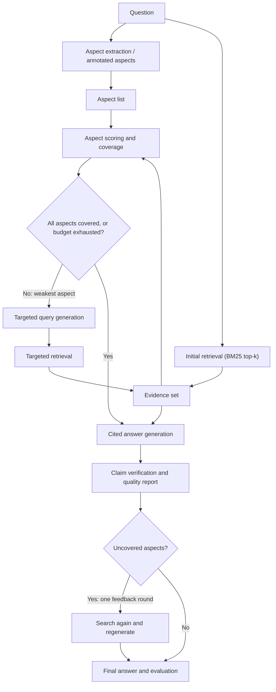

# Adaptive Aspect-Aware Retrieval for Reasoning-Intensive Question Answering

An adaptive retrieval-augmented generation (RAG) system for complex questions. It identifies the separate pieces of
information a question needs (its *aspects*), retrieves evidence for each, checks whether every aspect is covered,
and runs extra targeted retrieval **only where evidence is missing**. A language model then writes a cited answer from
the collected evidence, and the answer is verified claim by claim. The project evaluates whether this adaptive strategy
beats standard single-pass RAG on the [Bright-Pro](https://github.com/yale-nlp/Bright-Pro) benchmark.

## Highlights

- **Adaptive retrieval improves evidence recall without more search than needed.** Across all 739 Bright-Pro questions, average gold-document recall rises from 0.331 to 0.454 using 12.6 documents per question. A plain BM25 baseline given the same budget (top-13) reaches 0.375. Recall never decreased on any question, and 23.8% of questions needed no extra search.
- **More complete answers.** On 20 biology questions, the full system scores 4.25 / 5 on answer completeness versus 3.05 (dense RAG) and 2.75 (BM25 RAG), and covers 75% of the annotated aspects versus 46% and 35%.
- **Citation faithfulness is not improved** (support rate is about 0.55 for all three systems). The gain is completeness, not correctness. See [Limitations](#limitations).
- Modular, tested (65 tests), and every reported number can be regenerated from saved result files without any API key.

## How it works



1. **Retrieve.** One BM25 pass over the domain corpus gives the initial evidence.
2. **Score.** Each aspect gets a coverage score from the evidence. The controller picks the weakest aspect.
3. **Re-retrieve.** A targeted query is generated for that aspect and the new documents are merged into the evidence. The loop stops when all aspects are covered, gains stagnate, or the round, document or token budget is reached.
4. **Generate and verify.** An LLM answers only from the evidence and cites each claim. Each claim is checked against its cited documents, and answer completeness and aspect coverage are scored.
5. **Feedback.** If the verified answer leaves aspects uncovered, the system searches once more for them and regenerates the answer.

> **Note:** the experiments use Bright-Pro's annotated (gold) aspects. The LLM and rule-based aspect extractor for new, user-typed questions is implemented and tested, but is not used in the reported runs.

## Results

**Retrieval baselines** (top-10, all 739 questions, pooled gold recall, details in [docs/member1_retrieval.md](docs/member1_retrieval.md)):

| Retriever | Recall@10 | Avg. time per query |
|---|---|---|
| BM25 | 0.308 | 1.0 ms |
| Dense (bge-small) | 0.208 | 96.5 ms |

**Adaptive controller** (all 739 questions, per-question average recall, `python3 -m controller.compare`):

| Method | Docs | Extra rounds | Recall |
|---|---|---|---|
| BM25 top-10 | 10.0 | - | 0.331 |
| BM25 top-13 (matched budget) | 13.0 | - | 0.375 |
| Controller, target 0.38 | 11.5 | 0.73 | 0.410 |
| **Controller, default (target 0.5)** | **12.6** | **1.29** | **0.454** |
| Controller, target 0.6 | 13.3 | 1.64 | 0.483 |
| Controller, patience 2 | 13.1 | 1.55 | 0.461 |

**Answer quality** (20 biology questions, `experiments/generation/summary.md`, details in [docs/member5_generation.md](docs/member5_generation.md)):

| System | Support rate | Utility (1-5) | Gold-aspect coverage | Retrieval calls |
|---|---|---|---|---|
| Baseline, BM25 | 0.56 | 2.75 | 0.345 | 1.0 |
| Baseline, dense | 0.545 | 3.05 | 0.458 | 1.0 |
| **Full system** | 0.554 | **4.25** | **0.747** | 3.1 |

The two recall tables use different averaging (pooled over gold documents versus per question), so their baseline figures differ slightly.

Models used: generation and claim checking with `openai/gpt-oss-20b`, evaluation (utility and coverage) with a separate judge model, `qwen/qwen3.8-27b`, both through Groq's OpenAI-compatible API.

## Repository structure

```text
data/                  Dataset loader, preprocessing, inspection (Member 1)
retrieval/             BM25, dense retrieval, common interface, baselines (Member 1)
controller/            Aspect extraction, relevance scoring, adaptive controller (Members 2 and 4)
query_reformulation/   Targeted query generation and iterative retrieval (Member 3)
generation/            Cited generation, claim checking, quality report (Member 5)
evaluation/            Answer evaluation (Member 5)
experiments/           Saved results: baselines/, controller/, generation/
docs/                  Per-component documentation
tests/                 Unit and integration tests
indexes/               Search indexes, built on first use (git-ignored)
```

## Getting started

Requires Python 3.10+ (tested on 3.12 and 3.14).

```bash
git clone https://github.com/KotapatiSaiMounika/adaptive-aspect-rag.git
cd adaptive-aspect-rag
python3 -m venv .venv
source .venv/bin/activate          # Windows: .venv\Scripts\activate
pip install -r requirements.txt
```

Run all commands from the project root. The first retrieval call downloads the dataset (and, for dense retrieval, the embedding model) and builds the index for that domain. The "unauthenticated requests to the HF Hub" warning is harmless.

Only the generation and evaluation steps need an LLM:

```bash
cp .env.example .env               # then fill in your provider details
```

Example `.env` (the configuration used for the reported results; never commit this file):

```dotenv
LLM_BASE_URL=https://api.groq.com/openai/v1
LLM_API_KEY=<your key>
LLM_MODEL=openai/gpt-oss-20b
JUDGE_MODEL=qwen/qwen3.8-27b
```

| Variable | Purpose |
|---|---|
| `LLM_BASE_URL` | OpenAI-compatible endpoint (leave empty for OpenAI) |
| `LLM_API_KEY` | API key |
| `LLM_MODEL` | Model used for generation and claim checking |
| `JUDGE_MODEL` | Optional separate model for evaluation (defaults to `LLM_MODEL`) |
| `BRIGHT_PRO_DATA_ROOT` | Optional path to an offline dataset copy. Leave unset otherwise |

## Usage

```python
from retrieval.retrieval_interface import retrieve

docs = retrieve("why do birds migrate in winter", task="biology", method="bm25", top_k=10)
# [{"doc_id": ..., "text": ..., "score": ..., "retriever": "bm25"}, ...]
```

Domains (`task`): `biology`, `earth_science`, `economics`, `psychology`, `robotics`, `stackoverflow`, `sustainable_living`.

### Reproducing results

| Goal | Command | Needs | Approx. time |
|---|---|---|---|
| Offline unit tests | `pytest -q tests/test_controller.py tests/test_generation.py tests/test_member3.py tests/test_aspect_extractor.py tests/test_relevance.py tests/test_retrieval.py` | nothing | under 1 min |
| Full test suite | `pytest -q` | dataset + biology BM25 index | about 20 s after first run |
| Controller tables | `python3 -m controller.analyze` and `python3 -m controller.compare` | saved results | seconds |
| Toy controller demo | `python3 -m controller.demo` | nothing | seconds |
| Re-run controller | `python3 -m controller.run_all --out experiments/controller/new.jsonl` | dataset, BM25 indexes | minutes per domain |
| Retrieval baselines | `python3 -m retrieval.baseline --method bm25` (or `dense`) | indexes | BM25: minutes. Dense: hours on first build |
| Generation + evaluation | see below | LLM key | depends on provider rate limits |

Always pass `--out` to `controller.run_all`, otherwise it overwrites the committed results.

```bash
python3 -m generation.run_baseline --task biology --method bm25  --top_k 6 --limit 20
python3 -m generation.run_baseline --task biology --method dense --top_k 6 --limit 20
python3 -m generation.run_full --task biology --limit 20 --pause 30
python3 -m evaluation.evaluate_answers experiments/generation/baseline_bm25_biology.jsonl \
    experiments/generation/baseline_dense_biology.jsonl experiments/generation/full_biology.jsonl
```

All generation runs are resumable. Finished questions and judgements are skipped, so if the provider reports a rate limit you can simply wait and re-run.

Building all seven dense indexes takes about 6 hours on a CPU. Share a finished `indexes/` folder instead of rebuilding it (see [docs/member1_retrieval.md](docs/member1_retrieval.md)).

## Testing

```bash
pytest -q
```

65 tests cover the retrieval layer, aspect extraction and relevance scoring, the controller's decision logic, query generation, and the generation parsing code. LLM calls are never made in tests.

## Documentation

| Component | Document |
|---|---|
| Dataset, preprocessing and retrieval (Member 1) | [docs/member1_retrieval.md](docs/member1_retrieval.md) |
| Aspect extraction and document-aspect relevance (Member 2) | [docs/member2_aspects.md](docs/member2_aspects.md) |
| Query reformulation and iterative retrieval (Member 3) | [docs/member3_query_reformulation.md](docs/member3_query_reformulation.md) |
| Aspect scoring and the adaptive controller (Member 4) | [docs/member4_controller.md](docs/member4_controller.md) |
| Answer generation, verification and evaluation (Member 5) | [docs/member5_generation.md](docs/member5_generation.md) |

## Limitations

- **Small generation evaluation.** The answer-quality comparison covers 20 questions from one domain, so differences are indicative, not statistically significant. The retrieval results cover all 739 questions across 7 domains.
- **Gold-aspect coverage favours the adaptive system by design**, because it searches for the same aspects it is scored on. Support rate and completeness are the fairer comparison.
- **Support rate did not improve.** The full system mainly improves completeness and aspect coverage, not citation faithfulness.
- **Self-evaluated support.** The claim-level support check uses the generator model, so it can be biased. Only completeness and coverage use a separate judge.
- **Rule-based claim extraction** recognises only `[doc_id]` citations, so unusual citation formats lower a system's measured support rate.
- **Gold aspects are used in experiments.** The aspect extractor for free-form questions is not part of the reported results.
- **Models are not recorded per result.** The generator and judge names above come from the project configuration, not from the saved result files.
- LLM judgements are noisy and results depend on the models used.

## Related work and data

- **Bright-Pro**: Rethinking Reasoning-Intensive Retrieval: Evaluating and Advancing Retrievers in Agentic Search Systems (ACL 2026). Data and code: https://github.com/yale-nlp/Bright-Pro
- **FLARE**: Active Retrieval Augmented Generation (EMNLP 2023). https://aclanthology.org/2023.emnlp-main.495/
- **Self-RAG**: Learning to Retrieve, Generate, and Critique through Self-Reflection (ICLR 2024). https://proceedings.iclr.cc/paper_files/paper/2024/hash/25f7be9694d7b32d5cc670927b8091e1-Abstract-Conference.html
- **IRCoT**: Interleaving Retrieval with Chain-of-Thought Reasoning for Knowledge-Intensive Multi-Step Questions (ACL 2023). https://aclanthology.org/2023.acl-long.557/

## Team

| Name | Roll number | Member | Responsibility |
|---|---|---|---|
| Bodike Chaithali | B24CS013 | 1 | Dataset loading, preprocessing, BM25 and dense retrieval, common interface, baselines |
| Anushka Gawande | B24CS007 | 2 | Aspect extraction and document-aspect relevance |
| Bailapudi Kusuma Teja | B24CS011 | 3 | Query reformulation and iterative retrieval |
| Kotapati Sai Mounika | B24CS019 | 4 | Aspect scoring and the adaptive retrieval controller |
| Pulipati Parinita | B24CS037 | 5 | Cited generation, claim verification and evaluation |