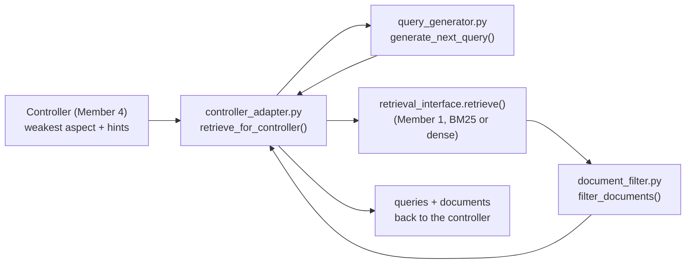

# Member 3: Query Reformulation and Iterative Retrieval

**Author:** Bailapudi Kusuma Teja (B24CS011)
**Code:** `query_reformulation/`
**Tests:** `tests/test_member3.py`, `tests/test_iterative_retriever.py`, `tests/test_member3_integration.py`

## Role in the system

When the adaptive controller (Member 4) finds that an aspect of the question is not covered by the current evidence, it needs
new documents for that aspect. This component turns the weak aspect into a **targeted search query**, runs it through the
shared retriever (Member 1), cleans the results, and hands new documents back to the controller.



The controller decides **what is missing and when to stop**. This component decides **what to search for and returns the
documents**. It never decides when to stop.

## Quick start

```python
from query_reformulation.controller_adapter import retrieve_for_controller

result = retrieve_for_controller(
    aspect_id="A2",
    aspect_text="effects of climate change",
    task="biology",
    original_question="What causes climate change and what are its effects?",
    previous_evidence=evidence,           # [{"doc_id", "text"}, ...]
    previous_queries=query_history,       # queries already used
    hints={"top_k": 10, "missing_terms": ["sea", "level"], "exclude_doc_ids": ["d1", "d7"]},
    method="bm25",
)

result["queries"]      # ["effects of climate change What causes ... additional evidence beyond ... sea level"]
result["documents"]    # [{"doc_id", "text", "score", "retriever", "retrieved_for_aspects", "retrieval_queries"}, ...]
```

This is exactly how `controller/run_all.py` and `generation/run_full.py` call it inside the retrieve loop.

## Files

| File | What it does |
|---|---|
| `controller_adapter.py` | **The entry point used by the reported experiments.** One call = one targeted retrieval round for the controller's weakest aspect. |
| `query_generator.py` | `generate_queries()` builds initial queries per aspect; `generate_next_query()` builds an evidence-aware follow-up query. |
| `query_expansion.py` | `expand_query()` returns up to 6 alternative phrasings of an aspect. |
| `document_filter.py` | `filter_documents()` validates, deduplicates, merges metadata, ranks and truncates a document list. |
| `iterative_retriever.py` | Standalone bounded retrieval over several aspects: `retrieve_for_aspects`, `retrieve_for_missing_aspect`, `iterative_retrieve`. |
| `pipeline.py` | `run_pipeline()`, a thin wrapper around `iterative_retrieve` for running the component on its own (has a small `__main__` demo). |

## How a query is built

### Follow-up query (`generate_next_query`)

Used for every controller round. The query is the concatenation of:

1. the **aspect text** (what is missing),
2. the **original question** (keeps the topic anchored),
3. `additional evidence beyond <first 150 characters of each of the first 2 evidence documents>`, or
   `detailed supporting evidence` if no evidence is available yet.

The result is whitespace-normalised and capped at 250 characters. Example:

```text
aspect:    effects of climate change
question:  What causes climate change and what are its effects?
evidence:  "Global warming increases temperatures."
query:     effects of climate change What causes climate change and what are its effects? additional evidence beyond Global warming increases temperatures.
```

If the generated query was already used, a fallback `"<aspect> further research findings"` is tried. If that was also used,
an empty string is returned, which means "nothing new to try".

### Initial queries (`generate_queries`, `expand_query`)

For each aspect, `generate_queries` produces 5 template variants (the aspect itself plus "supporting evidence", "causes and
consequences", "mechanisms and factors", "research findings and examples"). `expand_query` produces up to 6 further variants
("underlying mechanisms", "effects and implications", ...). Both accept strings or dicts and remove duplicates while keeping
order. Queries are rule-based: **no LLM and no API key is needed** for this component.

### Controller hints used by the adapter

| Hint (from Member 4) | What the adapter does |
|---|---|
| `top_k` | Number of documents requested for this query (default 5 if absent; the controller sends 10). |
| `missing_terms` | Aspect words found in none of the evidence; appended to the query so BM25 searches for them directly. |
| `exclude_doc_ids` | Documents already in the evidence; removed from the results so every returned document is new. |

## Document filtering (`filter_documents`)

- Drops non-dict items, items without `doc_id`, with empty or non-string text, or with a non-numeric score.
- Optional `min_score` cutoff.
- Deduplicates by `doc_id`. When a document appears twice, the **higher-scoring version is kept** and the
  `retrieved_for_aspects` and `retrieval_queries` lists of both are **merged** (nothing is lost).
- Sorts by score and returns the top `top_k`.

Every returned document is tagged with `retrieved_for_aspects` (which aspects it was fetched for) and `retrieval_queries`
(which queries found it), so later stages can trace why a document is in the evidence.

## Standalone iterative retrieval (`iterative_retrieve`)

A bounded two-phase retriever that does not need the controller:

1. **Phase 1, initial retrieval.** For each aspect, run template and expanded queries, skipping any already executed.
2. **Phase 2, evidence-guided follow-up.** For each aspect, run one `generate_next_query` using the documents found so far.

The query budget `max_queries` is split so that up to half of it (at most one slot per aspect) is reserved for phase 2.
Documents are merged across aspects with provenance kept. With `return_metadata=True` it returns
`{"documents", "by_aspect", "queries", "query_count"}`.

> **Note:** the reported experiments use the controller loop through `controller_adapter.py`. `iterative_retrieve`,
> `retrieve_for_aspects` and `pipeline.py` are an alternative batch-style interface, tested but not used in the reported numbers.

## Contract with the other members

| Direction | Contract |
|---|---|
| In from Member 4 | `aspect_id`, `aspect_text`, `previous_evidence`, `previous_queries`, `hints` (`top_k`, `missing_terms`, `exclude_doc_ids`). |
| Out to Member 4 | `{"queries": [...], "documents": [...]}`. Empty `queries` means no new query could be made, so the controller's `max_attempts_per_aspect` and stagnation rules end the loop. |
| Uses from Member 1 | `retrieval.retrieval_interface.retrieve(query, task, method, top_k)` returning `{"doc_id", "text", "score", "retriever"}`. |
| Used by Member 5 | The feedback round in `generation/run_full.py` calls the same adapter for aspects an answer left uncovered. |

Callers keep their own `query_history` (the adapter appends nothing itself) and add `result["queries"]` to it after each round.

## Behaviour in the full system

This component is the retrieval step of the adaptive loop, so its effect shows up in the shared controller results
(all 739 Bright-Pro questions, per-question average gold recall, `python3 -m controller.compare`):

| Method | Docs | Extra rounds | Recall |
|---|---|---|---|
| BM25 top-10 | 10.0 | - | 0.331 |
| BM25 top-13 (matched budget) | 13.0 | - | 0.375 |
| **Controller + targeted queries (default)** | **12.6** | **1.29** | **0.454** |

Targeted queries therefore beat simply retrieving more documents for the same budget (0.454 vs 0.375). These numbers are
the joint result of Members 3 and 4; no ablation isolates the query generator alone.

## Tests

```bash
pytest -q tests/test_member3.py                 # offline: no dataset, no index
pytest -q tests/test_iterative_retriever.py tests/test_member3_integration.py   # need dataset + biology BM25 index
```

`test_member3.py` checks query generation, expansion, follow-up query content, deduplication, empty input and metadata
merging in the filter. The iterative and integration tests check the query budget (`query_count <= max_queries`), empty-input
handling and that retrieval returns the expected structure. No LLM calls are made.

## Design decisions

- **Rule-based queries.** Fast, deterministic, free, and fully reproducible. Aspect text is already a focused phrase, and BM25
  rewards keeping its exact words.
- **Question and evidence context in the follow-up query.** Keeps the search on the original topic and nudges BM25 toward
  vocabulary from related documents.
- **Duplicate-safe by design.** Queries, documents and metadata are deduplicated at every step, so a repeated round cannot
  waste budget or add a document twice.
- **Inputs accepted in many shapes.** Aspects can be strings or dicts with `description`, `aspect`, `text` or `name`, so the
  component works with whatever format Members 2 and 4 produce.

## Limitations

- **Queries are templated, not learned.** An LLM-based rewriter could produce better queries, especially for questions needing
  multi-step reasoning. This was not tried.
- **Long queries.** A follow-up query contains the aspect, the full question and up to 300 characters of evidence, so BM25
  may weight the question's words as much as the aspect's. The words "additional evidence beyond" are generic and add noise rather than signal.
- **Evidence context is shallow.** Only the first two evidence documents are used, regardless of how relevant they are.
- **Template suffixes are domain-neutral** (for example "causes and consequences"), so some variants fit a given aspect poorly.
- **One query per controller round.** The adapter issues a single query per call; it does not combine several phrasings
  (that is what `iterative_retrieve` does).
- **No isolated evaluation.** Gains are measured only together with the controller, so the contribution of query
  reformulation alone is not separated out.
- **Exact-duplicate check only.** Two queries that differ by one word count as different, even if they retrieve the same documents.
